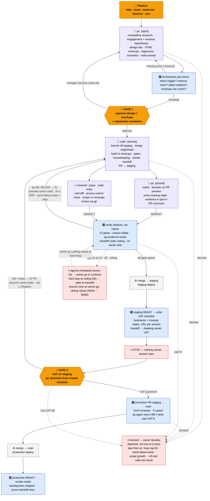
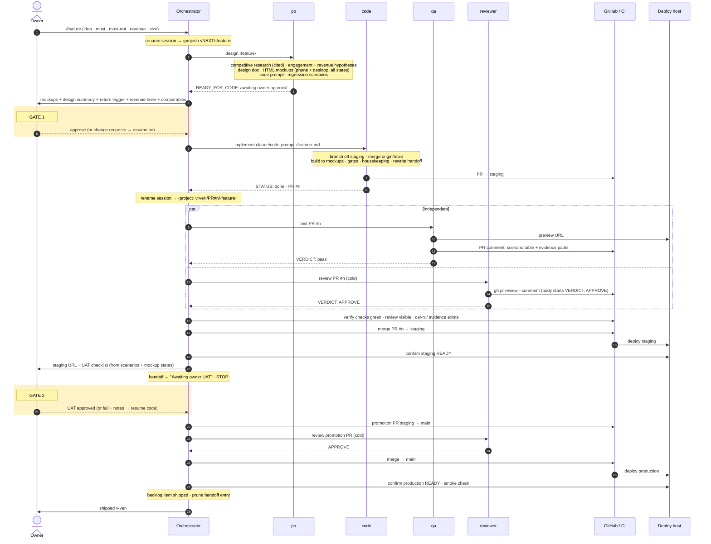
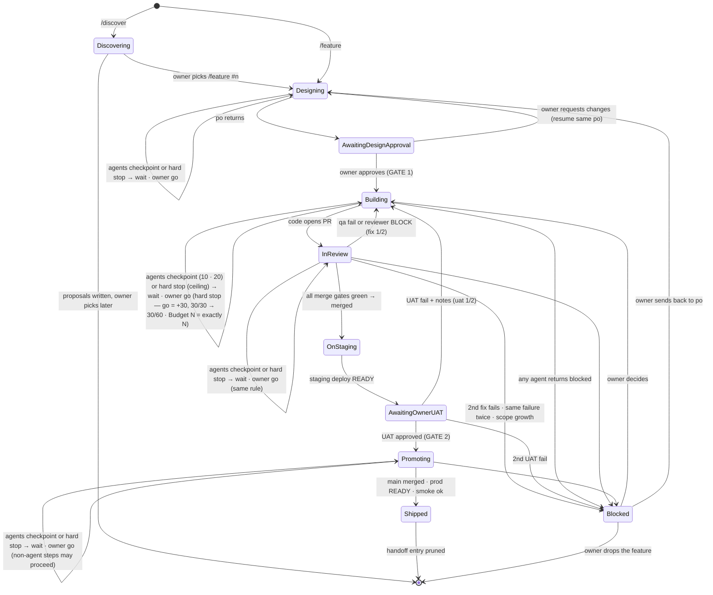

# Agent pipeline — how a feature ships

**Canonical rules:** `CLAUDE.md` → *Agent pipeline (orchestrator rules)* · **Agent definitions:** `.claude/agents/{po,code,qa,reviewer}.md`

This is the process diagram for how {{PROJECT_NAME}} features move from idea to production. Four subagents do the work; the main Claude Code session orchestrates; the owner touches it at exactly two gates. If this page and `CLAUDE.md` disagree, `CLAUDE.md` wins — fix this page. Install it as `docs/architecture/agent-pipeline.md`.

In the diagrams, `staging` means `{{STAGING_BRANCH}}`, `main` means `{{PROD_BRANCH}}`, and "deploy host" means {{DEPLOY_HOST}}. The Mermaid blocks deliberately contain no placeholders, so they render before and after substitution.

---

## 1. Overview — roles and the two owner gates

**Reading it:** amber = owner, blue = orchestrator, purple = subagent, grey = system, red = a hard stop. The two amber hexagons are the only places the owner must act; everything else runs once the gates in §4 pass. Dotted lines are `blocked` returns, which always go to the owner.

---

## 2. Happy path — sequence

---

## 3. Feature lifecycle — states as recorded in the handoff file

Every entry carries its state in the heading and a loop ledger directly beneath — `## <feature> — Building` / `Loops: fix 1/2 · uat 0/2 · agents 6/30 · po-bounce 1/1` — updated by the orchestrator on each transition, so caps survive session boundaries. `/status` prints them all. A feature appears in `{{HANDOFF_FILE}}` from `Designing` through `Promoting`. Once `Shipped` and production-verified, its entry is **deleted** — the PR, the changelog, the design doc, and any `claude/pr-*-review-findings.md` are the permanent record.

---

## 4. Gates — what must be true to move

| Transition | Required | Who checks |
|---|---|---|
| `po` → owner | `RETURN_TRIGGER` present · `REVENUE_LEVER` present or reasoned `none` · dated competitor citations · mockups don't look like a form | Orchestrator bounces to `po` before owner sees it |
| owner → `code` (**GATE 1**) | Owner approves design doc, mockups, and regression scenarios (no separate scenario gate) | **Owner** |
| any fix loop | fix attempts < 2 · the failure is not the same one as last attempt · agent calls below the next checkpoint or ceiling | Orchestrator, from the ledger — exceeding a cap → `Blocked` or checkpoint |
| PR → `{{STAGING_BRANCH}}` | CI green · `reviewer` APPROVE visible on PR · `qa` pass with evidence in `qa/<n>/` · `{{HANDOFF_FILE}}` rewritten, ≤ {{HANDOFF_MAX_LINES}} lines · design + mockups + regression scenarios owner-approved on record | Orchestrator — against artifacts, not agent claims. **Autonomous — no owner click** |
| `{{STAGING_BRANCH}}` → owner | Staging deployment `READY` for the merge commit · UAT checklist (one line per scenario / mockup state, staging URL per screen) written under `Awaiting owner UAT` | Orchestrator, then **stops** |
| owner → `{{PROD_BRANCH}}` (**GATE 2**) | Owner says "UAT approved" (or `/promote`) | **Owner — no exceptions, not even docs-only** |
| promotion PR → `{{PROD_BRANCH}}` | Previous promotion production-verified · CI green · fresh `reviewer` APPROVE · no second `qa` unless the diff differs from what was UAT'd | Orchestrator |
| `{{PROD_BRANCH}}` → done | Production deployment `READY` · smoke check of {{SMOKE_URL}} passes · backlog item marked shipped (if tracked) · handoff entry pruned | Orchestrator |

---

## 5. Separation of duties

| Role | Can | Cannot |
|---|---|---|
| **po** | Research, write docs + mockups + code prompt, commit to `claude/po-*` branch | Write app code · apply migrations · open PRs |
| **code** | Branch, build, test, housekeeping, open PR against `{{STAGING_BRANCH}}` | Merge anything · push to `{{PROD_BRANCH}}`/`{{STAGING_BRANCH}}` · apply prod migrations · delete · commit secrets |
| **qa** | Run suites, drive a browser on the preview, post findings on PR, save evidence | Modify app code · touch production data · act on real users |
| **reviewer** | Read diff, review (`gh pr review`) | **Write files at all** (tool allowlist) · commit · push · merge |
| **orchestrator** | Sequence, verify, merge to `{{STAGING_BRANCH}}`, open/merge promotion PR after owner UAT | Write app code · merge a PR it authored code for · promote without owner UAT |
| **owner** | Approve design (GATE 1), approve UAT (GATE 2), decide `blocked` items, apply prod migrations, override model mix | — |

Author ≠ promoter holds at every merge: `code` writes, `reviewer` judges cold, orchestrator merges. The reviewer's tool allowlist (`Read, Grep, Glob, Bash`, optionally plus a GitHub connector's read tools) is what makes "independent" mechanical rather than aspirational.

---

## 6. Artifacts — where each thing lives

| Artifact | Path | Written by | Lifetime |
|---|---|---|---|
| Design doc | `claude/<feature>-design.md` | po | Permanent (indexed in `claude/design-doc-index.md`) |
| Mockups | `{{MOCKUP_DIR}}/<feature>/*.html` + `README.md` | po | Permanent — the UI spec `code` builds to and `qa` tests against |
| Code prompt | `claude/code-prompt-<feature>.md` | po | Permanent |
| Feature PR | GitHub, base `{{STAGING_BRANCH}}` | code | Permanent |
| QA evidence | `qa/<pr>/*.png` (gitignored) + PR comment | qa | PR comment permanent; files local |
| Review | GitHub review on PR; optional `claude/pr-<n>-review-findings.md` | reviewer (orchestrator commits the doc) | Permanent |
| Open state | `{{HANDOFF_FILE}}` | code (per PR), orchestrator (session end, UAT, promotion) | **Pruned on ship** — ≤ {{HANDOFF_MAX_LINES}} lines, optionally CI-enforced |
| Lessons | the relevant `CLAUDE.md` section | whoever finds one | Permanent |

---

## 7. Owner-only actions (never delegated)

Applying a production migration · deleting user data, branches, or files the session didn't create · any payment, purchase, or transfer · promotion to `{{PROD_BRANCH}}` · anything a subagent returns as `blocked`. The orchestrator prepares the action, states exactly what will happen, and waits for an explicit yes.

---

## 8. Circuit breakers — why the loop can't run away

| Breaker | Limit | On trip |
|---|---|---|
| Fix loop (qa fail / reviewer BLOCK → code → re-run) | **2 attempts per PR** | `Blocked` → owner, with both diffs and the finding |
| Same failure reproduced after a fix (a flaky-looking CI failure counts) | **0 retries** — stop immediately | `Blocked` — it's a misunderstanding, not a bug |
| Owner UAT fail | **2 cycles per feature** | `Blocked` — owner picks: re-design (po) or drop |
| `po` pre-check bounce | **1** | Second return goes to the owner as-is, gaps listed |
| CI re-trigger | **1 run per commit**, never re-run to "see if it passes" | Red is read, not retried |
| Per-agent effort | **~40 tool calls (~60 for `po` in Discovery mode) or ~3 attempts at one sub-problem** without a reportable result | Agent returns `blocked` with what it tried |
| Feature-level agent calls | **Checkpoint every 10** (10, 20); **hard stop at 30** (the ledger denominator) | Checkpoint: stop, report, wait for the owner's go. Hard stop: write state to the handoff and recommend a fresh session. A bare "go" adds +30 (`30/30` → `30/60`); `Budget: agents N` sets it to N only if N > current count. Counters never reset. A hard stop halts agent calls only |
| Scope growth | PR touches **> 2×** the files the prompt named, or adds a dependency / migration / env var the prompt didn't | `reviewer` BLOCKs on scope → `Blocked`, not a fix loop |

`Blocked` is terminal for the session. A breaker trips on an event — a failure while its counter is already at the cap — not on the value. These are conventions enforced by orchestrator rules; a `PreToolUse` hook (matcher `Agent`) that counts calls is the mechanical upgrade. Not built.

## 9. Commands

| Command | What it does |
|---|---|
| `/discover [theme] [count]` | Research-only → ranked proposals written to `claude/discovery-<date>.md` on branch `claude/discovery-<date>` (no PR). One `po` call |
| `/feature` + up to 6 lines (idea · must · must-not · revenue angle · size · budget), or `/feature #n` | Kicks off the pipeline; stops only at GATE 1 and GATE 2 |
| `/promote` | From a fresh session: finds the feature awaiting UAT and runs the promotion flow |
| `/status [--live]` | Read-only dashboard: one line per open feature with its ledger |
| "UAT approved" / "UAT fail: <notes>" | In the live orchestrator session |
